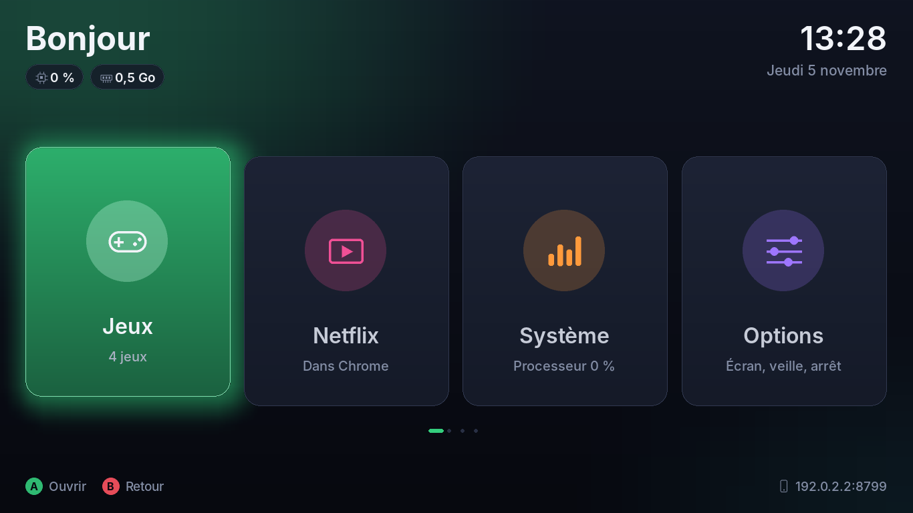
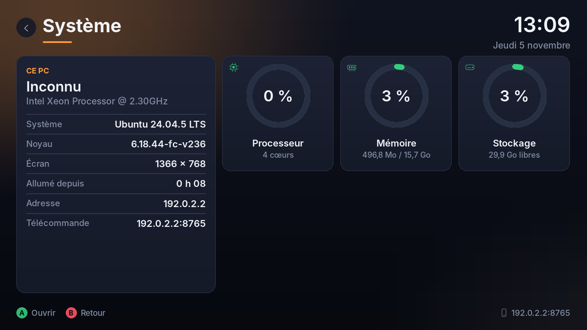
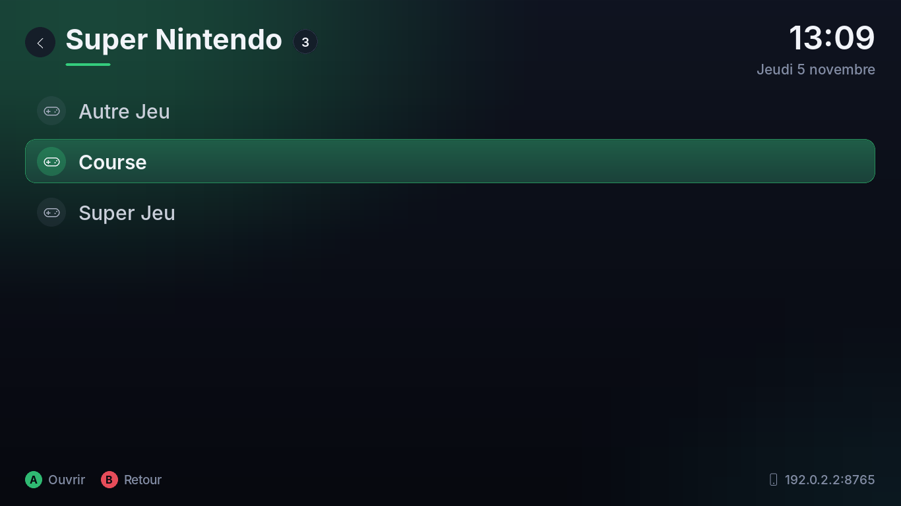

# Salon

Interface plein écran pour un petit PC Ubuntu : **jeux rétro, Netflix et infos du PC**, pilotée au clavier, à la manette, au doigt (écran tactile) ou depuis le téléphone, qui sert aussi à **envoyer des jeux**.

Elle est faite pour les machines faibles (Celeron, 2 à 4 Go de mémoire).





## Installer

```sh
git clone -b ccr-d0963a6c-u8wcle https://github.com/scalariapp-byte/RedLess- ~/RedLess-
bash ~/RedLess-/salon/installer.sh --session --netflix
bash ~/RedLess-/salon/optimiser.sh
```

| Option de `installer.sh` | Effet |
|---|---|
| *(aucune)* | installe Salon, RetroArch et un émulateur par console, et ajoute l'appli « Salon » au menu d'Ubuntu |
| `--session` | ajoute la session « Salon » (sans bureau) à l'écran de connexion |
| `--demarrage-auto` | le PC s'allume directement sur Salon, sans mot de passe |
| `--netflix` | installe Google Chrome pour la tuile Netflix |

Émulateurs installés d'office (serveur officiel de RetroArch, mis à jour à chaque nouvelle installation) : FCEUmm (NES), Snes9x (Super Nintendo), PicoDrive (Mega Drive, Master System), Gambatte (Game Boy), gpSP et mGBA (GBA), Mednafen PCE Fast (PC Engine), PCSX ReARMed (PS1), Mupen64Plus-Next (N64). Seul le BIOS de la PS1 reste à copier à la main, depuis ta console, dans `~/.config/retroarch/system/`.

Pour annuler le démarrage automatique : `sudo cp /etc/gdm3/custom.conf.avant-salon /etc/gdm3/custom.conf`.

## Envoyer des jeux depuis le téléphone

1. Sur le téléphone, connecté au même Wi-Fi, ouvre l'adresse affichée en bas à droite de l'écran (`http://<adresse du PC>:8765`).
2. En bas de la page, dans « Ajouter des jeux », appuie sur **Choisir des jeux** et sélectionne un ou plusieurs fichiers.
3. La console est trouvée toute seule (voir plus bas). Pour un `.7z`, ou un fichier dont la console reste introuvable, choisis-la dans la liste avant d'envoyer.
4. Une barre montre l'avancement ; le PC affiche « Jeu reçu » et le compte de jeux se met à jour.

Seules les extensions de jeux sont acceptées, et les fichiers vont uniquement dans `~/ROMs/<console>`. N'importe qui sur ton Wi-Fi peut ouvrir cette page : c'est un choix assumé pour un réseau de maison, pas pour un Wi-Fi public.

## Déposer des jeux en vrac

Pose les fichiers directement dans `~/ROMs` (clé USB, réseau, peu importe) : Salon les range dans le dossier de leur console à l'ouverture de « Jeux », et toutes les 30 secondes sur l'accueil. Il affiche « N jeux rangés par console ».

| Fichier | Console choisie |
|---|---|
| `.sfc` `.smc` `.nes` `.gb` `.gbc` `.gba` `.md` `.gen` `.sms` `.pce` `.z64` `.n64` `.pbp`… | d'après l'extension |
| `.zip` | d'après le jeu qu'il contient |
| `.cue`, `.chd` | PlayStation ; les `.bin` cités dans le `.cue` le suivent, même s'ils étaient déjà rangés ailleurs |
| `.bin` | PlayStation s'il fait plus de 16 Mo ou si un `.cue` le cite, sinon Mega Drive |
| `.7z` et le reste | laissé dans `~/ROMs`, avec un message : range-le à la main dans `~/ROMs/<console>` |

Un jeu identique déjà rangé n'est pas copié deux fois. Le BIOS PS1 reste à copier à la main dans `~/.config/retroarch/system/`. Seulement des copies de jeux que tu possèdes, ou des homebrews libres.

## Utiliser

| | Clavier | Manette | Téléphone |
|---|---|---|---|
| Se déplacer | flèches | croix ou stick gauche | ▲ ▼ ◀ ▶ |
| Valider | Entrée | A | OK |
| Revenir | Échap | B | Retour |
| Accueil | Début | Select ou bouton central | Accueil |
| Page suivante / précédente | Page ↓ / Page ↑ | RB / LB | ⏩ / ⏪ |
| Volume | + / − | | Vol + / Vol − |

Pendant un **jeu** : la manette appartient au jeu. **Select + Start** ensemble quittent le jeu, ou bien « Stop » sur le téléphone. RetroArch sauvegarde tout seul : le jeu reprend là où tu l'avais quitté.

Pendant **Netflix** : le site officiel s'ouvre dans Chrome en plein écran. Choisis un programme au doigt (écran tactile) ou à la souris ; ensuite OK met en pause, ◀ ▶ reculent ou avancent de 10 s, ▲ ▼ règlent le volume, Retour revient à la page précédente, **Stop** (téléphone) ou **Select + Start** (manette) ferment Netflix. Sur Linux, Netflix limite l'image à 720p.

**Mode tente** (convertible retourné) : Options → « Retourner l'écran ».

## Ce qui est optimisé (mesuré)

| | Valeur | Comment |
|---|---|---|
| Mémoire de Salon pendant un jeu ou Netflix | **34 Mo** | au lancement, Salon vide ses caches (images, fonds, textes, polices) et rend la mémoire au système (`malloc_trim`) ; le jeu ou Chrome en profitent |
| Mémoire de Salon dans les menus | 58 Mo | numpy et les modules audio de pygame bloqués ; mini-serveur HTTP fait main ; caches plafonnés : fonds au quart de la résolution, halos en demi-résolution, couleurs d'animation limitées à deux états |
| Processeur au repos | **0,4 %** | boucle qui dort entre deux vérifications (l'attente de SDL se réveille 1 000 fois par seconde dès qu'une manette est branchée) |
| Un pas sur l'accueil / une image d'animation | 9 ms / 4 ms | formes lissées calculées une fois puis gardées au format de l'écran ; rien n'est redessiné tant que rien ne change |

Le reste :
- **RetroArch** reçoit à chaque lancement des réglages légers (`~/.config/salon/retroarch-leger.cfg`) : rendu dans un fil séparé, ni shaders, ni retour arrière, ni run-ahead, menu RGUI ;
- les **émulateurs les plus légers** sont choisis d'abord : FCEUmm (NES), PicoDrive (Mega Drive), gpSP (GBA), PCSX ReARMed (PS1) ;
- **Chrome** démarre sans extensions ni synchronisation, avec au plus 2 processus d'affichage, et en mode « petit appareil » si le PC a moins de 3 Go ;
- la **session « Salon »** démarre l'interface sans le bureau GNOME, soit environ 1 Go de mémoire en moins (estimation) ;
- **`optimiser.sh`** allège Ubuntu lui-même (voir plus bas).

## Alléger Ubuntu

```sh
bash ~/RedLess-/salon/optimiser.sh            # applique
bash ~/RedLess-/salon/optimiser.sh --annuler  # remet comme avant
```

1. **Mémoire compressée (zram)** : la mémoire peu utilisée est compressée au lieu d'être écrite sur le disque. C'est le plus gros gain sur un PC à 2 Go.
2. **Services arrêtés** : impression (CUPS), modem 3G, rapports de plantage, indexation des fichiers de GNOME. Si tu imprimes depuis ce PC, relance l'impression avec `sudo systemctl enable --now cups`.

Rien n'est désinstallé. Snap n'est pas touché, parce que Firefox en dépend sur Ubuntu.

## Réglages

`~/.config/salon/config.json` ne contient que ce que tu changes :

```json
{
  "roms": "/home/moi/ROMs",
  "retroarch": "retroarch",
  "cores_dir": "",
  "navigateur": "google-chrome-stable",
  "netflix": "https://www.netflix.com/browse",
  "port_telecommande": 8765,
  "ecran_retourne": false
}
```

## Vérifier

```sh
python3 salon/test_salon.py            # parcourt tous les écrans et teste l'envoi de jeux, doit finir par OK
python3 salon/test_salon.py captures/  # en plus, une capture PNG de chaque écran
salon --fenetre                        # lance Salon dans une fenêtre 1280 × 720 au lieu du plein écran
```
